 
 

## Hakkımda

- 🎓 **Gazi Üniversitesi**, **Elektrik-Elektronik Mühendisliği** öğrencisiyim.
- 🔧 Çalıştığım konular: **Mikrodenetleyiciler**, **Basınç ölçümü**, **Haberleşme** (UART · RS485 · Modbus) ve **C**.
- 📚 Öğrendiklerimi haftalık raporlar ve **keyword** listesi hâlinde topluyorum.

## İletişim

