

<a href="https://github.com/berilmrc/Staj/tree/main/Hazirlik_haftalari/00_On_hazirlik_haftasi"></a><a href="https://github.com/berilmrc/Staj/tree/main/Hazirlik_haftalari/02_Hafta_2"></a><a href="https://github.com/berilmrc/Staj/tree/main/Staj_haftalari/Keywords/01_Basinc_ve_Olcum.md"></a><a href="https://github.com/berilmrc/Staj/tree/main/Staj_haftalari/Keywords/02_ADC_ve_Sinyal.md"></a><a href="https://github.com/berilmrc/Staj/tree/main/Staj_haftalari/Keywords/03_Haberlesme.md"></a> 
<a href="https://github.com/berilmrc/Staj/tree/main/Hazirlik_haftalari/01_Hafta_1"></a><a href="https://github.com/berilmrc/Staj/tree/main/Hazirlik_haftalari"></a><a href="https://github.com/berilmrc/Staj/tree/main/Staj_haftalari/Keywords/05_Guc_Elektronigi_ve_Suruculer.md"></a> 
<a href="https://github.com/berilmrc/Staj"></a><a href="https://github.com/berilmrc?tab=repositories"></a><a href="https://github.com/berilmrc/Staj/tree/main/Staj_haftalari/Keywords/"></a><a href="https://github.com/berilmrc/Staj/tree/main/Staj_haftalari/Keywords/06_Guc_Dagitimi_ve_Devre.md"></a> 
<a href="https://github.com/berilmrc/Staj/tree/main/Staj_haftalari/03_Hafta_3"></a><a href="https://github.com/berilmrc/Staj/tree/main/Staj_haftalari"></a><a href="https://github.com/berilmrc/Staj/tree/main/Staj_haftalari/Keywords/08_MCU_Mimarisi_ve_Bellek.md"></a><a href="https://github.com/berilmrc/Staj/tree/main/Staj_haftalari/Keywords/07_Pnomatik_ve_Valfler.md"></a> 
<a href="https://github.com/berilmrc/Staj/tree/main/Staj_haftalari/Keywords/10_Yazilim_ve_Gelistirme_Araclari.md"></a><a href="https://github.com/berilmrc/Staj/tree/main/Staj_haftalari/Keywords/09_STM32_Cevre_Birimleri.md"></a>

## Hakkımda

- 🎓 **Gazi Üniversitesi**, **Elektrik-Elektronik Mühendisliği** öğrencisiyim.
- 🔧 Çalıştığım konular: **STM32**, **Statik Port**, **Haberleşme** (UART · RS485 · Modbus) ve **C**.
- 📚 Öğrendiklerimi haftalık raporlar ve **keyword** listesi hâlinde topluyorum.

## İletişim

