## 📂 Projelerim

<table>
<tr>
<td width="50%" valign="top">

### 📘 [Staj](https://github.com/berilmrc/Staj)

</td>
<td width="50%" valign="top">

### 🔑 [Keywords](https://github.com/berilmrc/Staj/tree/main/Staj_haftalari/Anahtar_Kelimeler)

</td>
</tr>
</table>

## 🗓️ Staj Yolculuğu

| Dönem | Konu |
|---|---|
| 🧩 Hazırlık Haftası | Elektronik temelleri |
| 1️⃣ 1. Hafta | Şematik okuma, dijital mantık, C'ye giriş |
| 2️⃣ 2. Hafta | C derinleşme, mikrodenetleyici kavramı, Wokwi |
| 3️⃣ 3. Hafta | STM32 simülasyon ödevleri |
| 4️⃣ 4. Hafta | Kavramsal tasarım |

## 📫 İletişim

